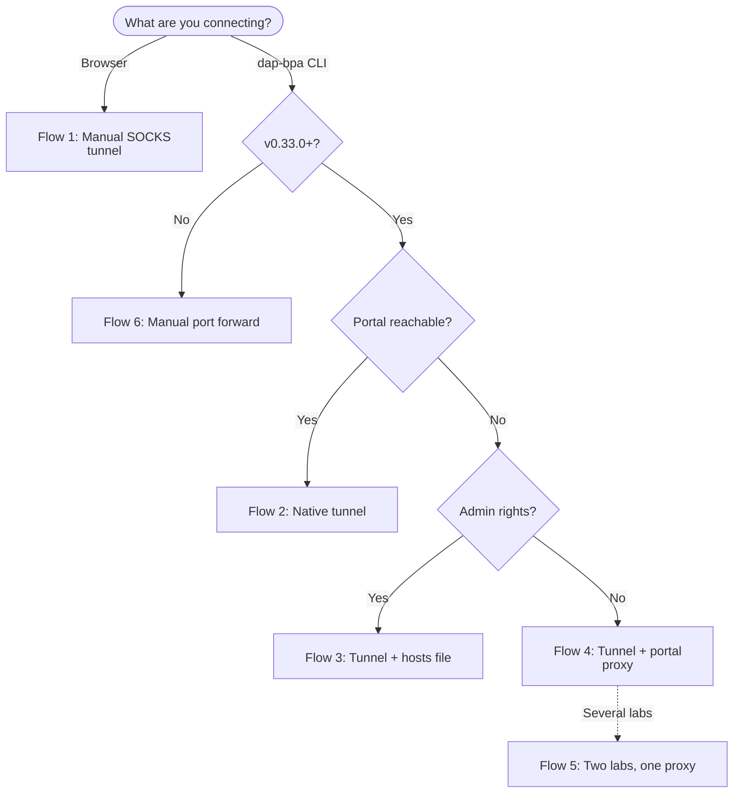
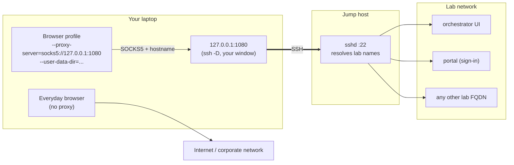
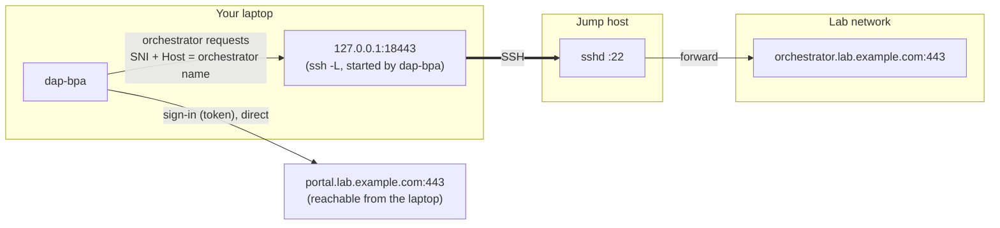
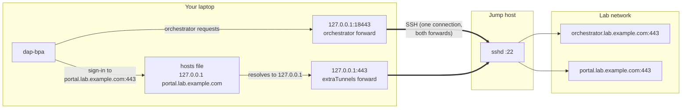
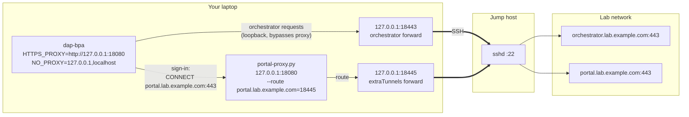
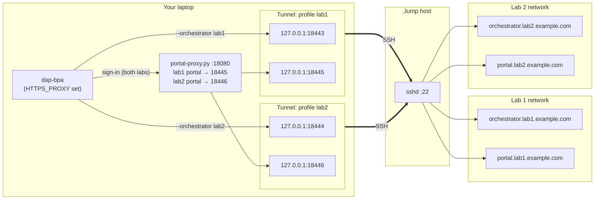
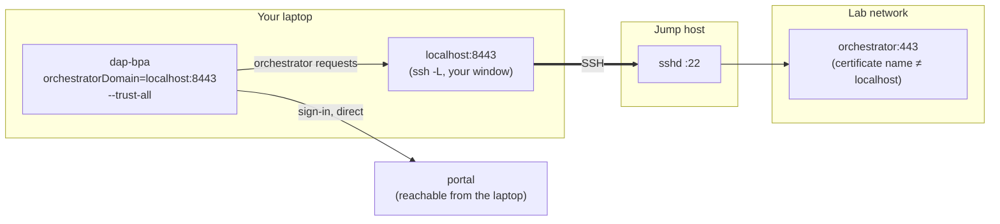
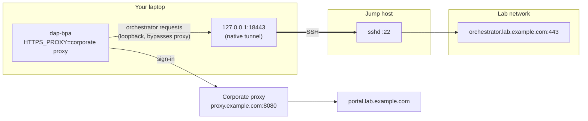
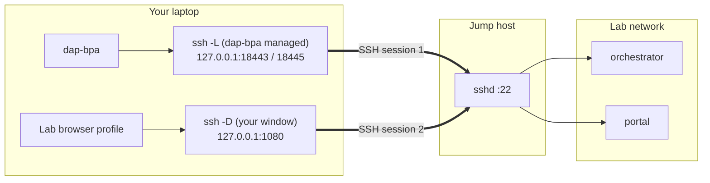

# Section 016: Tunnel Connections

**Tunnel setup: local laptop → jump host → remote network.**

## Overview

Lab orchestrators often sit on an isolated network that you can reach only through an SSH jump host. This section covers two ways to get there:

- **Native dap-bpa tunnel (v0.33.0+)** - `dap-bpa orchestrator tunnel` starts and supervises an SSH port forward for an orchestrator profile, and every orchestrator command for that profile is sent through it automatically. Use this for the CLI.
- **Manual SSH tunnel** - a SOCKS proxy you run yourself with `ssh -D`, for browsing the remote network (the orchestrator UI, the portal) or when the native tunnel does not fit your setup.

---

## Tunnel Flow Diagrams

The diagrams below show every supported way traffic gets from your laptop to the lab. Each uses the same three zones: **your laptop**, the **jump host**, and the **lab network** behind it. Solid arrows are connections; the SSH connection between the laptop and the jump host is the only one that crosses the network boundary.

### Which Flow Do I Need?

"Browser" covers the orchestrator UI and the portal. "Portal reachable?" asks whether your laptop can reach the portal without the jump host. "Admin rights?" asks whether you can edit the hosts file on your laptop.



| Flow | Use it for | Orchestrator traffic | Portal sign-in traffic | Admin rights |
| ---- | ---------- | -------------------- | ---------------------- | ------------ |
| 1 | Browser | SOCKS tunnel | SOCKS tunnel | No |
| 2 | CLI, portal reachable | Native tunnel | Direct | No |
| 3 | CLI, portal behind jump host | Native tunnel | Hosts file → `extraTunnels` port | Yes |
| 4 | CLI, portal behind jump host | Native tunnel | Portal proxy → `extraTunnels` port | No |
| 5 | CLI, several labs | One native tunnel per profile | One portal proxy, one route per lab | No |
| 6 | CLI before v0.33.0 | Manual `ssh -L` | Direct | No |
| 7 | CLI behind a corporate proxy | Native tunnel (bypasses the proxy) | Corporate proxy | No |

### Flow 1: Manual SOCKS Tunnel (Browser)

`ssh -D 1080` opens a SOCKS5 proxy. A separate browser profile sends every request, including the hostname, to it, and the jump host resolves lab names and connects. The orchestrator UI's redirect to the portal follows the same path. See [Manual SSH Tunnel](#manual-ssh-tunnel-browser-access).



### Flow 2: Native Tunnel, Portal Reachable Directly

dap-bpa starts `ssh -L` in the background and sends orchestrator requests to `127.0.0.1:18443`, with the real orchestrator name in the TLS SNI and `Host` header. Sign-in goes straight to the portal. See [Native dap-bpa Tunnel](#native-dap-bpa-tunnel-v0330).



### Flow 3: Native Tunnel + Portal Through the Tunnel (Hosts File)

The portal is also behind the jump host. `extraTunnels` adds a second forward on local port `443` (`"443:portal.lab.example.com:443"`) to the same `ssh` process, and a hosts-file entry makes the portal's real name lead to `127.0.0.1`. `portalDomain` is `portal.lab.example.com:443`. The local port must be `443`: the portal's Keycloak sign-in redirects back to the portal on port 443, so a different local port breaks the redirect. See [Reaching the Portal for Sign-In](#reaching-the-portal-for-sign-in).



### Flow 4: Native Tunnel + Portal Proxy (No Admin Rights)

Like Flow 3, the portal is forwarded through the tunnel, here on local port `18445` (any free port works). Instead of a hosts file, dap-bpa sends sign-in through `HTTPS_PROXY` to the local [portal proxy](https://github.com/tme-tech-ops/blueprint-assist-training/tree/main/4.examples/tunnel-portal-proxy). The proxy answers `CONNECT portal.lab.example.com:443` by connecting to the `18445` forward, and TLS runs end to end with the real portal name. Orchestrator requests go to `127.0.0.1`, which is in `NO_PROXY` and always bypasses the proxy. `portalDomain` stays `portal.lab.example.com`.



### Flow 5: Two Labs, One Portal Proxy

Each profile runs its own `ssh` process with its own ports. One portal proxy serves both labs, picking the forward by hostname. This is the setup from the [walkthrough](#walkthrough-windows-jump-host-two-labs).



### Flow 6: Manual Port Forward (dap-bpa Before v0.33.0)

You run `ssh -L 8443:...` yourself and point `orchestratorDomain` at `localhost:8443`. dap-bpa addresses the orchestrator as `localhost`, so the certificate name does not match and `--trust-all` is usually needed. See [Using with dap-bpa CLI](#using-with-dap-bpa-cli).



### Flow 7: Native Tunnel Behind a Corporate Proxy

When the laptop reaches the portal only through a corporate HTTP(S) proxy, sign-in follows `HTTPS_PROXY`. Orchestrator requests to the tunnel's `127.0.0.1` port always bypass the proxy, whether it comes from the environment or the profile's `proxy` block. The SSH connection to the jump host does not use the HTTP proxy at all. See [Corporate Proxies](#corporate-proxies-v0330).



### Running Flows Side by Side

Native tunnels and a manual SOCKS tunnel are separate `ssh` processes on separate local ports, so the CLI and the browser can use the lab at the same time.



---

## Native dap-bpa Tunnel (v0.33.0+)

dap-bpa runs your machine's own OpenSSH client (`ssh` / `ssh.exe`) in the background with keep-alives, forwards a local port to the orchestrator through the jump host, and routes the profile's orchestrator commands through `127.0.0.1:<port>`. The HTTP `Host` header and TLS SNI are set to the real orchestrator domain, so certificate checks still run against the orchestrator's own name.

### Requirements

- OpenSSH client on your PATH (built into Windows 10/11, macOS, and most Linux distributions)
- SSH access to the jump host with **key-based sign-in**, working from a plain `ssh` command first (see [Set Up Key-Based Sign-In](#set-up-key-based-sign-in))
- A named orchestrator profile in `~/.blueprint-assist/config.json` with `orchestratorDomain`, `portalDomain`, `orgId`, `clientId`, and `clientSecret` (see Section 3). The key is `clientId`: a profile that spells it `clientID` is shown by `dap-bpa status` but fails orchestrator commands with `DAP_ORCHESTRATOR_DOMAIN and DAP_TOKEN must be set`
- If the portal is also behind the jump host, a way to reach it for sign-in (see [Reaching the Portal for Sign-In](#reaching-the-portal-for-sign-in))

### Set Up Key-Based Sign-In

Use an SSH key for the jump host. With password sign-in, `tunnel start --interactive` asks for the password, but dap-bpa gives the local port only 3 seconds to come up, and that time runs while you are still typing. Start then fails with:

```text
Error: SSH tunnel failed: port 18443 did not become ready within 3000ms (PID 18020). Tunnel failed: ERR_TUNNEL_SSH_FAILED.
```

1. **Add the jump host to `~/.ssh/config`** on your machine. For a Windows jump host with a domain account:

   ```text
   Host jumphost
       HostName 10.0.1.100
       User <domain>\<username>
       ServerAliveInterval 30
       ServerAliveCountMax 3
   ```

   `ssh -G jumphost` prints the settings `ssh` will use without connecting, which is a quick way to check the user name was read correctly.

2. **Use a key without a passphrase**, or one loaded in `ssh-agent`. dap-bpa runs `ssh` in the background, so it cannot answer a passphrase prompt either. If you have no key yet, run `ssh-keygen -t ed25519`.

3. **Install the public key on the jump host.** Sign in once with your password (`ssh jumphost`) and add the contents of your `.pub` file to the right file. On a Windows jump host running OpenSSH Server:

   - Check whether your account is an administrator there: `whoami /groups | findstr /i "S-1-5-32-544"`
   - **Not an administrator**: append the key to `%USERPROFILE%\.ssh\authorized_keys`
   - **Administrator** (the command above prints a line): append it to `%ProgramData%\ssh\administrators_authorized_keys` instead; OpenSSH ignores the per-user file for administrators. Then restrict the file, or OpenSSH ignores it:

     ```cmd
     icacls %ProgramData%\ssh\administrators_authorized_keys /inheritance:r /grant "Administrators:F" /grant "SYSTEM:F"
     ```

   On a Linux jump host, `ssh-copy-id jumphost` does this for you.

4. **Check that no prompt appears.** This must return without asking for anything:

   ```powershell
   ssh -o BatchMode=yes jumphost exit
   ```

### Configure the Profile

Add a `tunnel` block to the profile in `~/.blueprint-assist/config.json`:

```json
{
  "orchestrators": {
    "lab": {
      "portalDomain": "portal.lab.example.com",
      "orchestratorDomain": "orchestrator.lab.example.com",
      "orgId": "your-org-id",
      "clientId": "your-client-id",
      "clientSecret": "your-client-secret",
      "environmentType": "lab",
      "tunnel": {
        "jumpHost": "jumphost",
        "targetHost": "orchestrator.lab.example.com",
        "targetPort": 443
      }
    }
  }
}
```

| Field | Required | Description |
| ----- | -------- | ----------- |
| `tunnel.jumpHost` | Yes | Jump host name, address, or a `Host` alias from `~/.ssh/config` |
| `tunnel.targetHost` | Yes | Orchestrator host as seen from the jump host |
| `tunnel.targetPort` | Yes | Orchestrator port (usually `443`) |
| `tunnel.jumpUser` | No | SSH user name (omit to use your `~/.ssh/config` or local default) |
| `tunnel.jumpPort` | No | SSH port on the jump host (default `22`) |
| `tunnel.localPort` | No | Preferred local port (default `18443`) |
| `tunnel.extraTunnels` | No | Extra `ssh -L` forward specifications, for example `"18080:other-host.lab.example.com:443"` |
| `environmentType` | No | Profile environment label. Tunnels to a profile whose `environmentType` is `production` are refused (`ERR_TUNNEL_SAFETY_VIOLATION`) |

The jump host value is passed to `ssh` unchanged, so anything in your `~/.ssh/config` applies: `ProxyJump`, `ProxyCommand`, `IdentityFile`, user names. dap-bpa never stores or reads your private keys. Using the `Host` alias (as above) rather than an address keeps the user name and key settings in one place; leave `tunnel.jumpUser` unset in that case.

Each profile that should run its tunnel at the same time as another needs its own `localPort` (for example `18443` and `18444`).

### Tunnel Commands

```bash
# Start the tunnel for a profile (runs in the background)
dap-bpa orchestrator tunnel start --profile lab

# Check it (exits 1 when the tunnel is down - usable in scripts)
dap-bpa orchestrator tunnel status --profile lab

# List running tunnels
dap-bpa orchestrator tunnel list

# Use the profile as normal - commands go through the tunnel automatically
dap-bpa orchestrator blueprints list --orchestrator lab

# Stop the tunnel
dap-bpa orchestrator tunnel stop --profile lab
```

Global flags such as `--orchestrator` (`-o`) go **after** the command. `dap-bpa -o lab orchestrator blueprints list` fails with `Unknown command: -o`.

A successful start and status look like this:

```json
{
  "profile": "lab",
  "status": "RUNNING",
  "local_port": 18443,
  "jump_host": "jumphost",
  "target": "orchestrator.lab.example.com:443",
  "pid": 38712,
  "uptime_seconds": 41
}
```

`status` for a profile whose tunnel is not running prints `"status": "STOPPED"` with a `reason` and exits `1`. `tunnel list` shows running tunnels only; it prints `[]` when none are running, even if profiles have a `tunnel` block.

Start tunnels from an interactive terminal and leave it open, or at least do not start them from a shell that is torn down after each command. In testing, a tunnel started from a non-interactive tool shell (the kind an IDE agent uses) exited as soon as that shell finished, and `status` then reported `Process exited unexpectedly`.

| Command / Flag | Purpose |
| -------------- | ------- |
| `orchestrator tunnel start [--profile <name>]` | Start a background tunnel (defaults to the active profile) |
| `--port <port>` | Override the local port for this start |
| `--interactive` | Run with a terminal attached, for jump hosts that ask for a password or MFA code. In v0.33.1 the 3-second port check runs while you type, so start usually fails; use key-based sign-in instead |
| `--verbose` | Print diagnostics, including the `ssh` command line (credentials redacted). `DEBUG=1` does the same |
| `orchestrator tunnel status [--profile <name>]` | Check that the tunnel process is running and the local port is listening |
| `orchestrator tunnel list` | List running tunnels |
| `orchestrator tunnel stop [--profile <name>]` | Stop the tunnel |
| `--json` | Machine-readable output on any tunnel command |
| `--no-tunnel` (global) | Send a command directly to the orchestrator even though the profile defines a tunnel |

Short forms work too: `dap-bpa o t start --profile lab`.

### How It Behaves

- **Local port**: `18443` by default (or `tunnel.localPort`). If it is taken, dap-bpa tries `18444` to `18500`; if all are taken, start fails with `ERR_TUNNEL_PORT_CONFLICT`.
- **Session state**: each running tunnel is recorded in `~/.blueprint-assist/tunnels/<profile>.json`. Stale entries left by a crashed or killed `ssh` process are detected and cleaned up.
- **Tunnel not running**: an orchestrator command for a tunnel profile fails with the exact `dap-bpa orchestrator tunnel start --profile <name>` command to run, or `--no-tunnel` to bypass it.
- **SSH failures**: the error includes `ssh`'s own message with remediation guidance. Re-run with `--verbose` to see the command dap-bpa ran.
- **Production safety**: a profile with `"environmentType": "production"` cannot be tunneled. Production changes go through your normal promotion pipeline.

### Reaching the Portal for Sign-In

The tunnel carries **orchestrator** traffic only. Before each command, dap-bpa signs in to the DAP **portal** (`portalDomain`) to get a token, and those calls do not use the tunnel. If the portal is also behind the jump host, the tunnel comes up but every command fails at sign-in:

```text
Failed to discover token endpoint, using default: Unable to connect. Is the computer able to access the url?
Failed to generate actor token: Was there a typo in the url or port?
Error: Failed to generate token: Failed to generate actor token. Please check your credentials.
```

The fix has two parts:

1. **Forward the portal through the same tunnel** with `extraTunnels`:

   ```json
   "tunnel": {
     "jumpHost": "jumphost",
     "targetHost": "orchestrator.lab.example.com",
     "targetPort": 443,
     "localPort": 18443,
     "extraTunnels": ["18445:portal.lab.example.com:443"]
   }
   ```

   For the hosts-file option below, forward local port `443` instead: `"extraTunnels": ["443:portal.lab.example.com:443"]`. The portal's Keycloak sign-in redirects back on port 443, so the hosts-file route only works when the local port is also `443`. The portal proxy works with any local port.

2. **Make the portal's real hostname lead to that port.** Pointing `portalDomain` at `127.0.0.1:18445` does not work: the portal only answers when it is addressed by its own name (TLS SNI and `Host` header). Use one of these:

   | Option | Needs admin rights | Setup |
   | ------ | ------------------ | ----- |
   | Hosts-file entry | Yes | Add `127.0.0.1 portal.lab.example.com` to the hosts file (`C:\Windows\System32\drivers\etc\hosts` or `/etc/hosts`), forward local port `443` (`"443:portal.lab.example.com:443"`), and set `"portalDomain": "portal.lab.example.com:443"` |
   | Local portal proxy | No | Keep `"portalDomain": "portal.lab.example.com"`, run the [portal proxy](https://github.com/tme-tech-ops/blueprint-assist-training/tree/main/4.examples/tunnel-portal-proxy) with `--route portal.lab.example.com=18445`, and set `HTTPS_PROXY=http://127.0.0.1:18080` and `NO_PROXY=127.0.0.1,localhost` in the shell where you run dap-bpa |

   To add the hosts-file entry on Windows, run this in a PowerShell window opened with **Run as administrator**:

   ```powershell
   Add-Content -Path "$env:SystemRoot\System32\drivers\etc\hosts" -Value "127.0.0.1 portal.lab.example.com"
   ```

   Remove the line again when you stop using the tunnel; while it is there, the portal name only works while the tunnel is running.

   Sign-in requests follow the `HTTPS_PROXY` environment variable; the per-profile `proxy` block below applies to orchestrator requests only. In PowerShell, `$env:HTTPS_PROXY = "..."` lasts for that window, so set it in the same window as `dap-bpa`.

Once sign-in reaches the portal, a remaining failure is about the credentials themselves:

```text
[debug] Token generation failed: 401 {"http_status_code":401,"messages":[{"severity":"ERROR","code":"0x0001050003","message":"failed to validate client credentials", ...}]}
```

Run with `--debug` to see this message. It means the portal was reached and rejected the `clientId` / `clientSecret` (or `orgId`) in the profile; get current values for that portal and update the profile.

#### Walkthrough: Windows Jump Host, Two Labs

This is the full setup, tested end to end with dap-bpa v0.33.1, for two lab orchestrators (`lab1`, `lab2`) whose orchestrator and portal are reachable only from a Windows jump host, on a laptop without admin rights:

1. `~/.ssh/config` has the `jumphost` entry from [Set Up Key-Based Sign-In](#set-up-key-based-sign-in), the public key is in `administrators_authorized_keys` on the jump host, and `ssh -o BatchMode=yes jumphost exit` returns without a prompt.
2. Each profile in `~/.blueprint-assist/config.json` gets its own ports:

   ```json
   "lab1": {
     "portalDomain": "portal.lab1.example.com",
     "orchestratorDomain": "orchestrator.lab1.example.com",
     "orgId": "your-org-id",
     "clientId": "your-client-id",
     "clientSecret": "your-client-secret",
     "environmentType": "lab",
     "tunnel": {
       "jumpHost": "jumphost",
       "targetHost": "orchestrator.lab1.example.com",
       "targetPort": 443,
       "localPort": 18443,
       "extraTunnels": ["18445:portal.lab1.example.com:443"]
     }
   },
   "lab2": {
     "portalDomain": "portal.lab2.example.com",
     "orchestratorDomain": "orchestrator.lab2.example.com",
     "orgId": "your-org-id",
     "clientId": "your-client-id",
     "clientSecret": "your-client-secret",
     "environmentType": "lab",
     "tunnel": {
       "jumpHost": "jumphost",
       "targetHost": "orchestrator.lab2.example.com",
       "targetPort": 443,
       "localPort": 18444,
       "extraTunnels": ["18446:portal.lab2.example.com:443"]
     }
   }
   ```

3. Window 1 runs the portal proxy and stays open:

   ```powershell
   python portal-proxy.py --route portal.lab1.example.com=18445 --route portal.lab2.example.com=18446
   ```

4. Window 2 runs dap-bpa:

   ```powershell
   $env:HTTPS_PROXY = "http://127.0.0.1:18080"
   $env:NO_PROXY = "127.0.0.1,localhost"
   dap-bpa orchestrator tunnel start --profile lab1
   dap-bpa orchestrator tunnel start --profile lab2
   dap-bpa orchestrator blueprints list --orchestrator lab1
   dap-bpa orchestrator blueprints list --orchestrator lab2
   ```

#### Two or More Labs With the Hosts File

With admin rights, you can skip the proxy. Each portal needs local port `443`, and only one tunnel can listen on `127.0.0.1:443`, so give each lab its own loopback address (`127.0.0.1`, `127.0.0.2`, and so on). dap-bpa passes each `extraTunnels` entry to `ssh -L` unchanged, so an entry can start with the address to listen on.

1. Add one hosts-file line per portal, each with its own address. In PowerShell opened with **Run as administrator**:

   ```powershell
   Add-Content -Path "$env:SystemRoot\System32\drivers\etc\hosts" -Value "127.0.0.1 portal.lab1.example.com"
   Add-Content -Path "$env:SystemRoot\System32\drivers\etc\hosts" -Value "127.0.0.2 portal.lab2.example.com"
   ```

2. In each profile, forward the portal on that address and port `443`, and set `portalDomain` to the portal name on port `443`:

   ```json
   "lab1": {
     "portalDomain": "portal.lab1.example.com:443",
     "tunnel": {
       "localPort": 18443,
       "extraTunnels": ["127.0.0.1:443:portal.lab1.example.com:443"]
     }
   },
   "lab2": {
     "portalDomain": "portal.lab2.example.com:443",
     "tunnel": {
       "localPort": 18444,
       "extraTunnels": ["127.0.0.2:443:portal.lab2.example.com:443"]
     }
   }
   ```

   The other profile and tunnel fields stay as in step 2 above.

3. Start both tunnels and run commands. No proxy and no `HTTPS_PROXY` are needed:

   ```powershell
   dap-bpa orchestrator tunnel start --profile lab1
   dap-bpa orchestrator tunnel start --profile lab2
   dap-bpa orchestrator blueprints list --orchestrator lab1
   dap-bpa orchestrator blueprints list --orchestrator lab2
   ```

If you only use one lab at a time, every hosts line can use `127.0.0.1`, with the forward `"443:portal.labN.example.com:443"`, as long as just one of those tunnels runs at once.

### Corporate Proxies (v0.33.0+)

dap-bpa also honors an HTTP(S) proxy for its outbound calls:

- `HTTP_PROXY`, `HTTPS_PROXY`, and `NO_PROXY` environment variables are detected automatically
- A per-profile `proxy` block takes precedence over the environment:

```json
"proxy": {
  "url": "http://proxy.example.com:8080",
  "noProxy": ["localhost", ".example.com"]
}
```

`proxy.url` must be an `http://` or `https://` URL (SOCKS proxies are not supported for dap-bpa traffic - use the native tunnel instead). Loopback destinations, including the native tunnel's `127.0.0.1` port, always bypass the proxy, and a password embedded in a proxy URL is redacted from logs.

The `proxy` block covers orchestrator requests. Sign-in requests to the portal follow `HTTPS_PROXY` / `NO_PROXY` from the environment, so if the portal is only reachable through a proxy, set the environment variables as well.

---

## Manual SSH Tunnel (Browser Access)

Create a SOCKS proxy tunnel from your local machine through a remote Windows jump host to browse any FQDN on the remote network. For dap-bpa CLI traffic, prefer the [native tunnel](#native-dap-bpa-tunnel-v0330) above.

---

## Prerequisites

### Local Machine

- SSH client (OpenSSH built into Windows 10/11, or PuTTY)
- Network connectivity to the jump host (VPN or direct network access)

### Jump Host (Windows Server)

- OpenSSH Server installed and running (see [Jump Host Setup](#jump-host-setup-one-time))
- Network connectivity to the target network (orchestrator, etc.)

---

## Quick Start

This uses the `jumphost` entry and SSH key from [Set Up Key-Based Sign-In](#set-up-key-based-sign-in), so no password is needed. It runs alongside native dap-bpa tunnels without affecting them.

### Step 1: Create the tunnel

Open PowerShell and run:

```powershell
ssh -D 1080 -N jumphost
```

The window shows nothing and appears to "hang" - **this is normal**. Keep it open; closing it stops the tunnel. Without the `~/.ssh/config` entry, use `ssh -D 1080 -N -o ServerAliveInterval=60 -o ServerAliveCountMax=3 <domain>\<username>@<jump-host-ip>` and enter your password.

Check it is listening before opening a browser:

```powershell
netstat -an | findstr ":1080"
```

You should see `TCP    127.0.0.1:1080    0.0.0.0:0    LISTENING`. If not, read the error in the tunnel window.

### Step 2: Open a separate browser profile that uses the tunnel

```powershell
# Microsoft Edge
& "C:\Program Files (x86)\Microsoft\Edge\Application\msedge.exe" --proxy-server="socks5://127.0.0.1:1080" --user-data-dir="$env:LOCALAPPDATA\lab-browser"

# Google Chrome
& "C:\Program Files\Google\Chrome\Application\chrome.exe" --proxy-server="socks5://127.0.0.1:1080" --user-data-dir="$env:LOCALAPPDATA\lab-chrome"
```

`--user-data-dir` is what makes this work while your normal browser is open. Without it, the command hands the URL to the browser that is already running, which ignores `--proxy-server`, and lab names fail with `ERR_NAME_NOT_RESOLVED`. The separate profile also keeps your everyday browsing off the tunnel, and it remembers certificate exceptions for next time.

To confirm a window is using the tunnel, open `chrome://version` (or `edge://version`) in it: the **Command Line** entry must include `--proxy-server=socks5://127.0.0.1:1080`.

### Step 3: Browse to your remote site

In that window, go to any hostname on the remote network, for example:

```text
https://portal.lab.example.com
https://orchestrator.lab.example.com
```

With a SOCKS5 proxy, Chrome and Edge send the hostname to the proxy and the jump host looks it up, so lab names work without hosts-file entries or admin rights. The orchestrator UI redirects to the portal to sign in, which also goes through the tunnel. Accept certificate warnings for self-signed lab servers (Advanced > Continue).

---

## Command Reference

### SSH Parameters

| Parameter | Description |
| ----------- | ------------- |
| `-D 1080` | Create SOCKS proxy on local port 1080 |
| `-N` | No remote command (tunnel only) |
| `-v` | Verbose mode (shows connection status) |
| `-f` | Background mode (not recommended on Windows) |
| `-o ServerAliveInterval=60` | Send keepalive every 60 seconds (already set by the `jumphost` entry) |
| `-o ServerAliveCountMax=3` | Disconnect after 3 missed keepalives |

### Username Formats

When you connect without a `~/.ssh/config` entry and authentication fails, try different formats:

| Shell | Format |
| ------- | -------- |
| PowerShell | `domain\username@host` or `"domain\username@host"` |
| Bash/Git Bash | `'domain\username'@host` or `domain\\username@host` |
| Any | `username@host` (if domain is automatic) |

In `~/.ssh/config`, write it as `User <domain>\<username>`.

---

## Browser Configuration

### Chrome and Edge

Use the commands in [Step 2](#step-2-open-a-separate-browser-profile-that-uses-the-tunnel). Both browsers read `--proxy-server` only when they start a new profile, so always pair it with `--user-data-dir`. Use `socks5://127.0.0.1:1080` rather than `localhost`.

### Firefox (Built-in Settings)

Firefox has its own proxy settings, so it does not need a separate launch command. Use a separate Firefox profile (`firefox.exe -P`) if you do not want all of its traffic to go through the tunnel.

1. Settings > Network Settings > Settings button
2. Select "Manual proxy configuration"
3. SOCKS Host: `127.0.0.1` | Port: `1080`
4. Select **SOCKS v5**
5. Check **"Proxy DNS when using SOCKS v5"** (important - without it, lab names do not resolve)

> **Important:** Do NOT add `:1080` to your destination URLs. The proxy port is configured separately from the URL.

---

## Using with dap-bpa CLI

Use the [native tunnel](#native-dap-bpa-tunnel-v0330) for dap-bpa. dap-bpa does not send its traffic through a SOCKS proxy, so setting `HTTP_PROXY` / `HTTPS_PROXY` to a `socks5://` address does not work.

If you cannot use the native tunnel (for example, on a dap-bpa release before v0.33.0), run a direct port forward yourself and keep the window open:

```powershell
ssh -L 8443:your-orchestrator.internal:443 -N -o ServerAliveInterval=60 -o ServerAliveCountMax=3 <domain>\<username>@<jump-host-ip>
```

Then point a profile's `orchestratorDomain` at `localhost:8443` in `~/.blueprint-assist/config.json` and run commands against it:

```powershell
dap-bpa orchestrator blueprints list --orchestrator lab
```

Because the certificate is issued for the orchestrator's name, not `localhost`, this manual approach usually needs `--trust-all`. The native tunnel avoids that by sending the real orchestrator name in the `Host` header and TLS SNI.

> **Note:** A profile with `"insecure": true` in `config.json` is treated the same as `--trust-all`: certificate verification is turned off and every command prints the `[AuthManager] WARNING: --trust-all is enabled` message. For self-signed lab orchestrators, prefer trusting the lab CA with `dap-bpa setup --ca-cert <path>`, and use `insecure` or `--trust-all` only when that is not possible (see Section 3).

---

## Verification

### Check if tunnel is listening

```powershell
netstat -an | Select-String "1080"
```

You should see:

```text
TCP    127.0.0.1:1080    0.0.0.0:0    LISTENING
```

### Test with curl

```powershell
curl.exe -k --socks5-hostname 127.0.0.1:1080 https://your-orchestrator.internal
```

> **curl tips:**
>
> - Use `--socks5-hostname` (not `--socks5`) to resolve DNS through the proxy
> - Use `127.0.0.1` instead of `localhost` (Windows curl quirk)
> - Use `-k` to skip certificate verification for self-signed certs

### Detect a dead tunnel

If `netstat` shows only `SYN_SENT` connections (no `LISTENING`), the tunnel died. Restart it.

---

## Alternative Methods

### SSH Config (Persistent Setup)

Add to `~/.ssh/config`:

```text
Host jump-host
    HostName <jump-host-ip>
    User <domain>\<username>
    DynamicForward 1080
    ServerAliveInterval 60
    ServerAliveCountMax 3
```

Then connect with:

```powershell
ssh -N jump-host
```

### PuTTY GUI

1. Session → Host Name: `<jump-host-ip>`
2. Connection → SSH → Tunnels:
   - Source port: `1080`
   - Select **Dynamic**
   - Click "Add"
3. Session → Save as "JumpHostSOCKS" → Open

### PLink Command Line

```cmd
plink -D 1080 -N <domain>\<username>@<jump-host-ip>
```

---

## Troubleshooting

### Browser: ERR_NAME_NOT_RESOLVED

The browser is not using the tunnel, so it looked the lab name up with your normal DNS.

- Check the tunnel is up: `netstat -an | findstr ":1080"` must show `LISTENING`
- Use the window opened with `--proxy-server` **and** `--user-data-dir`; a browser started from the taskbar or Start menu has no proxy. `chrome://version` (or `edge://version`) shows the flags in use
- In Firefox, check **Proxy DNS when using SOCKS v5**

### Certificate Errors (HTTPS)

Internal servers often use self-signed certificates.

**Browser:** Click "Advanced" → "Proceed to site (unsafe)"

**curl:** Add `-k` flag to skip verification

### Empty Reply from Server

The tunnel is working, but wrong protocol. Try `https://` instead of `http://`.

### curl: (97) Could not resolve proxy: localhost

Use `127.0.0.1` instead of `localhost`:

```powershell
curl.exe --socks5-hostname 127.0.0.1:1080 https://your-server.internal
```

### Connection Refused

- Verify jump host has OpenSSH Server running (see [Jump Host Setup](#jump-host-setup-one-time))
- Check firewall allows port 22
- Verify network connectivity to jump host

### Tunnel Drops Frequently

Ensure you're using keepalive settings:

```powershell
ssh -D 1080 -N -o ServerAliveInterval=60 -o ServerAliveCountMax=3 <domain>\<username>@<jump-host-ip>
```

### Port 1080 Already in Use

Use a different port:

```powershell
ssh -D 1081 -N -o ServerAliveInterval=60 -o ServerAliveCountMax=3 <domain>\<username>@<jump-host-ip>
```

Update browser proxy to `socks5://localhost:1081`.

### Stop the Tunnel

For a native tunnel, use `dap-bpa orchestrator tunnel stop --profile <name>`. For a manual tunnel, close its window or stop the process:

```powershell
Get-Process ssh | Stop-Process
```

This stops every `ssh` process, including native dap-bpa tunnels.

### Native Tunnel Errors

| Error | Cause | Fix |
| ----- | ----- | --- |
| `Tunnel for profile '<name>' is not running` | The profile has a `tunnel` block but no tunnel is up | Run `dap-bpa orchestrator tunnel start --profile <name>`, or add `--no-tunnel` |
| `ERR_TUNNEL_PORT_CONFLICT` | Ports `18443` to `18500` are all in use | Free a port, or pass `--port <port>` |
| `ERR_TUNNEL_SAFETY_VIOLATION` | The profile's `environmentType` is `production` | Tunnels are not allowed to production profiles |
| `ERR_TUNNEL_SSH_FAILED` | `ssh` could not connect or authenticate | Check `ssh jumphost` works on its own; re-run with `--verbose` |
| `port 18443 did not become ready within 3000ms` (with `ERR_TUNNEL_SSH_FAILED`) | `ssh` was waiting for a password or passphrase | Set up [key-based sign-in](#set-up-key-based-sign-in); `ssh -o BatchMode=yes jumphost exit` must return without a prompt |
| `does not have a 'tunnel' block` | The profile has no tunnel configuration | Add a `tunnel` block (see [Configure the Profile](#configure-the-profile)) |
| `Process exited unexpectedly` (from `status`) | The `ssh` process ended, for example because the shell that started it closed | Start the tunnel again from an interactive terminal |
| `Failed to discover token endpoint ... Unable to connect` | The portal is not reachable from your machine; the tunnel carries orchestrator traffic only | See [Reaching the Portal for Sign-In](#reaching-the-portal-for-sign-in) |
| `401 ... failed to validate client credentials` (with `--debug`) | The portal was reached but rejected the profile's credentials | Update `clientId`, `clientSecret`, and `orgId` for that portal |
| `DAP_ORCHESTRATOR_DOMAIN and DAP_TOKEN must be set` with `--orchestrator <name>` | The profile is missing `orchestratorDomain`, or spells `clientId` as `clientID` | Add `orchestratorDomain`; rename the key to `clientId` |
| `Unknown command: -o` | A global flag was put before the command | Put it after: `dap-bpa orchestrator blueprints list --orchestrator lab` |

---

## Jump Host Setup (One-Time)

Run these commands **on the jump host** as Administrator:

```powershell
# Install OpenSSH Server
Add-WindowsCapability -Online -Name OpenSSH.Server~~~~0.0.1.0

# Start and enable SSH service
Start-Service sshd
Set-Service -Name sshd -StartupType 'Automatic'

# Verify SSH is running
Get-Service sshd
```

### Firewall Configuration

```powershell
# Check if firewall rule exists
Get-NetFirewallRule -Name *ssh*

# If not, create it
New-NetFirewallRule -Name sshd -DisplayName 'OpenSSH Server (sshd)' -Enabled True -Direction Inbound -Protocol TCP -Action Allow -LocalPort 22
```

---

## Security Notes

- Use SSH keys instead of passwords when possible
- SOCKS proxy bypasses local network security - use only for trusted networks
- Close tunnel when not needed
- All browser traffic goes through the tunnel when proxy is enabled
- Consider VPN as alternative for persistent access
